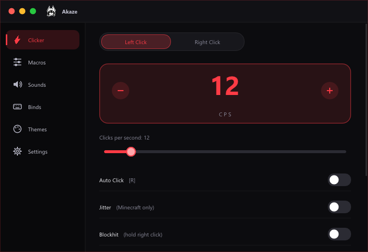

<div align="center">

# Akaze

**A small, fast and transparent autoclicker for Minecraft on Windows.**
Made in Brazil 🇧🇷 by [Gazake](https://github.com/Gazake1).

[](https://github.com/Gazake1/AkazeClicker/actions/workflows/build.yml)


**[Website & download](https://gazake1.github.io/akaze-site/)** · **[Releases](https://github.com/Gazake1/AkazeClicker/releases)** · [Português](README.pt-BR.md)

</div>

<div align="center">



</div>

---

## What it does

Akaze presses your mouse button for you, at a speed you choose (1–100 clicks per second), while you hold the
button. Arm it with a hotkey, hold the mouse button, and it clicks for as long as you hold.
It was designed for Minecraft, but the core works in any window.

### Clicker
| Feature | What it does |
|---|---|
| **Left / Right** | Each side has its own hotkey and CPS (1–100) |
| **Inventory** | Click with the cursor visible (off = in-game only) |
| **Blockhit** | While right click is held, releases the block only during the hit |
| **Jitter + Speed** | Tiny mouse movements on every left click, undone on the next one (up to 15 px). Works **only while Minecraft, or a known Minecraft launcher/client, is the active window**; auto click itself works everywhere. Left click only |
| **Target window only** | Acts only while the captured window is in focus |
| **Hover tips** | Rest the mouse on a function name for ~3 seconds to see what it does |
| **Activation mode** (Settings) | *Hold the button* (default) or *Press once* to click non-stop, like a classic autoclicker |
| **Hide to tray** | The green dot hides the window in the system tray; it keeps working in the background |

### Macros
| Feature | What it does |
|---|---|
| **Slot whitelist** | Clicks only on the hotbar slots you tick. *Fetch Binds* reads your slot keys from `options.txt` (read-only) |
| **Throwpot** | Switches to the potion slot, throws, and returns to the previous slot (configurable delay) |
| **W-Tap** | Releases W for a few milliseconds after a hit to reset sprint |

### Sounds, binds, themes and settings
Click sounds (8 built-in mouse sounds + 4 synthesized + any `.wav` in the `sounds` folder), key binds, theme colors with a Rainbow mode, and an English / Portuguese language switch. Settings are saved to `%APPDATA%\Akaze\config.txt`.

## How it works

1. Press the arm key (default `R`) to arm a side.
2. Hold the mouse button you want to click with. Akaze reads the **physical** state of your buttons through a
   low-level mouse hook that ignores injected clicks, so its own clicks never confuse it.
3. Each cycle it holds the button for half of the interval, releases, waits the other half and plays the click
   sound, with a natural ±20% timing variation. A 1 ms system timer keeps the rhythm even.
4. Let go and it stops instantly.

## Transparency

What Akaze does **not** do:

- It does not access the memory of other processes.
- It does not use the network: nothing is downloaded or sent.
- It does not install itself (no registry entries, no scheduled tasks).
- It does not self-delete, run shell commands or wipe traces.

It only uses standard Windows APIs: `mouse_event` / `SendInput` (clicks and key presses), `GetAsyncKeyState`
(only the keys you configured), a mouse hook (physical button state and scroll only), `GetCursorInfo`,
`GetForegroundWindow`, `PlaySound` and `Shell_NotifyIcon` (tray icon). **There is no keyboard hook.**
To know whether Minecraft is in focus (Jitter only), it reads the **title and the program file name of the active window**
(for example `javaw.exe`), and nothing else about other programs: it never reads their memory. It never clicks while its
own window is the active one.
Files it touches: its own `config.txt` in `%APPDATA%\Akaze` and a `sounds` folder next to the executable
(created on first run, read-only use); it also reads `%APPDATA%\.minecraft\options.txt` when you press *Fetch Binds*.

> [!WARNING]
> Some antivirus programs flag every autoclicker as PUA/HackTool, even without malware. Blockhit, jitter, throwpot and
> W-tap are easier for anti-cheats to detect, and many Minecraft servers forbid autoclickers. Use it at your own risk and
> check your server's rules.

## Download

Get the executables from **[Releases](https://github.com/Gazake1/AkazeClicker/releases)**. Each release lists the SHA-256
of every file.

| File | When to use |
|---|---|
| `Akaze.exe` | Standard version |
| `Akaze-Admin.exe` | When the game or launcher runs as administrator (asks for UAC) |

Windows SmartScreen may show "unknown publisher" for new, unsigned programs: click **More info → Run anyway**, or
right-click the file → **Properties → Unblock**.

## Build from source

```bat
winget install BrechtSanders.WinLibs.POSIX.UCRT
build.bat
```

`build.bat` downloads Dear ImGui at a **pinned commit** (reproducible builds), compiles with MinGW-w64, strips the
binary and creates `Akaze-Admin.exe` with [`tools/make-admin.ps1`](tools/make-admin.ps1). A CMake alternative is in
[`CMakeLists.txt`](CMakeLists.txt). Releases are built by [GitHub Actions](.github/workflows/build.yml) from this
repository.

## Code signing policy

> Free code signing provided by [SignPath.io](https://signpath.io), certificate by
> [SignPath Foundation](https://signpath.org).

**Status:** a free certificate is being requested from the SignPath Foundation. Until it is granted, releases are **not signed**.

- **Authors, reviewers and approvers:** [Gazake](https://github.com/Gazake1) (sole maintainer). Every release is
  approved by the maintainer; the maintainer's GitHub and SignPath accounts use multi-factor authentication.
- **Only this project's own binaries are signed**, built from the source in this repository by the automated
  workflow in `.github/workflows/build.yml`. Third-party libraries are linked statically but never signed separately.
- **Privacy policy:** this program will not transfer any information to other networked systems unless specifically
  requested by the user or the person installing or operating it. (It does not use the network at all.)

## Repository layout

```
main.cpp                 the whole program (clicker, macros, UI)
app.rc                   icon + version metadata
akaze.manifest       manifest for the Admin build
click_sounds.h           embedded mouse-click sounds
sounds_data.h            embedded synthesized sounds
logo_data.h              embedded logo
build.bat                reproducible build (pinned Dear ImGui)
tools/make-admin.ps1     creates Akaze-Admin.exe
CMakeLists.txt           CMake alternative
.github/workflows/       CI: build and release
dist/sounds/             example .wav files
```

## License

[MIT](LICENSE) © 2026 Gazake. Third-party notices in [THIRD_PARTY_NOTICES.md](THIRD_PARTY_NOTICES.md).
